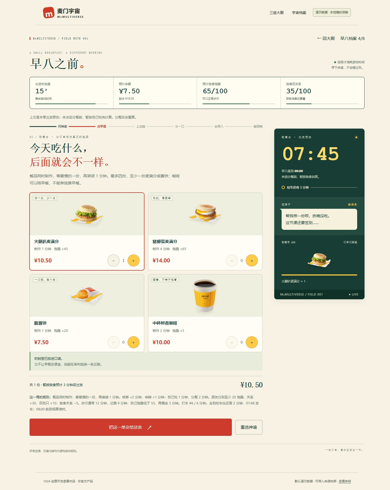
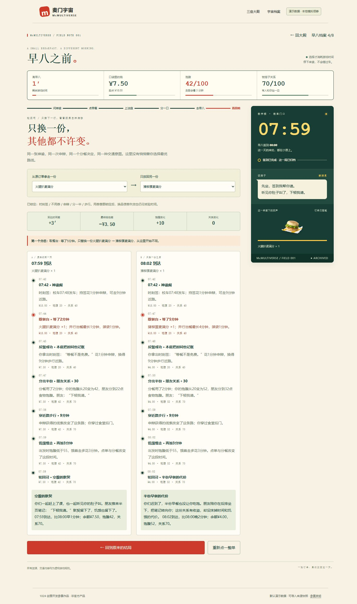
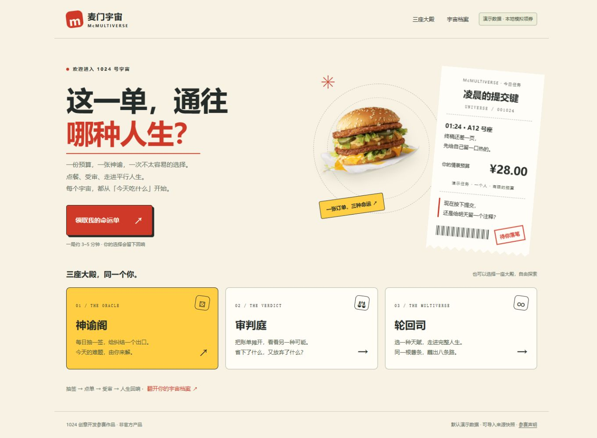
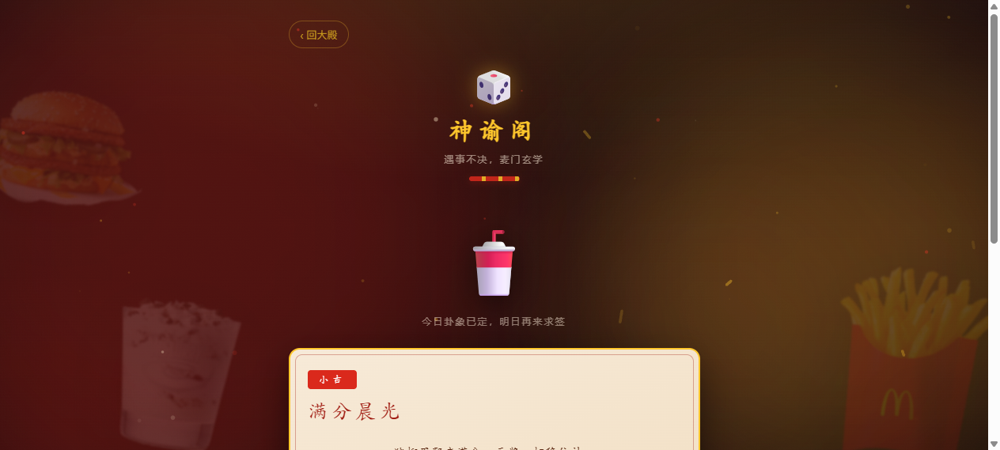
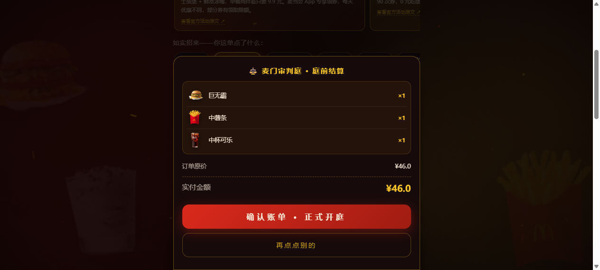
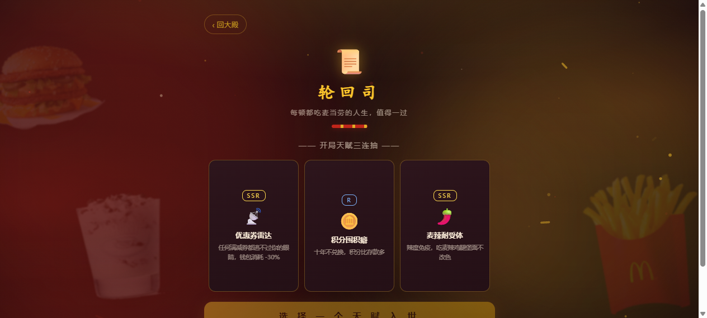

# 麦门宇宙 · McMultiverse

> 一张订单，三种命运。你想吃的、你付出的、你最终成为的，未必是同一个答案。

 

以麦门文化为题材的静态互动游戏，也是麦当劳中国 MCP 创意开发比赛的参赛演示项目。主体验是约 **3 分钟的早八局**：07:42，18 元，校车六分钟后发车，朋友却还没吃早餐。点单、分餐和交通会真正改变钱、时间、饱腹与关系；结尾可换一份餐品，对照两条时间线。原有其他短局、三殿独立玩法与长篇分支剧情继续保留。

界面把门店取餐台、朋友消息、时钟与命运小票放进同一个现场。运行时**零第三方依赖、无构建步骤、无后端**；原生 HTML/CSS/JavaScript 与菜单图片均使用相对路径。

默认价格、优惠券和处境均为**游戏演示规则**。页面可以加载整理后的公开商品快照，但不会在浏览器中实时调用 MCP，也不操作真实账户、领券或下单。当前实现与数据边界见 [MCP 集成说明](MCP_INTEGRATION.md)。

<p align="center">
  
  
</p>

以下为保留的三殿独立玩法：

<p align="center">
  
  
  
</p>
<p align="center">
  
  
</p>

## 先赶这一场早八

1. **神谕阁只带走一张签。** 时刻签给近路线索；优惠签解锁适用的早餐演示券，用券需要两分钟核验。
2. **从空订单开始点。** 每样餐品展示价格、游戏等待时间和饱腹值；不替玩家预先配好答案。慢餐更饱，快餐保住赶车机会。
3. **审判庭接受反驳。** 接受钱包判词，或凭时刻签用一分钟申辩，获得更短的步行路线。
4. **分一半，再选怎么走。** 自己吃或分给朋友会交换饱腹、关系和时间。校车有明确发车边界；步行受路线和饱腹影响；打车要从真实剩余游戏预算扣费。不可用的路线说明原因。
5. **轮回司按实际状态收束。** 到达是否准时、是否吃饱、朋友关系共同决定八种主结局。每段因果都能追溯到订单与选择。
6. **换一份，看两条线。** 只替换原单里的一份餐品，其他输入全部锁定。对照资源、事件与第一个分岔；若新单导致券失效、超预算或赶不上原路线，显示断点，不自动换交通来制造假结果。

思考时不走真实倒计时；只有做出的行动消耗游戏分钟。等待、饱腹、关系、交通和结局均为**虚构游戏规则，不是门店服务时长或营养模型**。早八存档与八种结局使用独立本地档案，保存小票和公开重玩链接可在结果页使用。

“其他命运单”仍可进入深夜赶稿、饭搭子短篇；旧版 `#mc=1` 链接继续使用原规则，新早八使用 `#am=1`，两种版本不混算。

## 三座大殿，也可以独立探索

| 入口 | 玩法 |
|---|---|
| 神谕阁 | 抽取麦运签，阅读签诗、宜忌与推荐；签文是娱乐文本，不是预测模型。 |
| 审判庭 | 看图点餐、领演示券、核对报价、参加庭审与上诉；订单不会发送至真实门店。 |
| 轮回司 | 选择天赋，经历分支人生，解锁路线与结局，带着前世记忆转世。 |

长篇人生保留八条路线：麦门职员、考研自习室、健身叛徒、发疯文学、薅羊毛党、麦门神谕、积分赌狗、薯条行为艺术。天赋影响每次选择的属性结算，转世递增代数并保留关键记忆。体重、钱包、信仰和健康均为**虚构游戏数值**。

主结局使用稳定 ID；随机墓志铭与属性修饰不重复计为不同主结局。收藏保存在当前浏览器，清理网站数据或更换浏览器后不会自动同步。

## 计价可以复核

金额内部统一按整数分计算，再格式化为元。同款同量比较与增加商品的方案分开说明。

- 单品券、买一送一、固定份数组合券和满减券按明确条件计算。
- 同一商品候选券按有效报价比较，领取顺序不改变结果。
- 数量、商品或有效期不符的券不抵扣；券后报价不得高于该组合原价。
- 满减叠加按数据中的明确规则处理，不能靠券名猜测套餐组成。
- 凑单把新增商品费用一并计算；只有最终实付下降才称为省钱。

例如，演示规则中“脆薯饼 2 份 ¥9.9”按两份合计 ¥9.9 计算，不会把单份价格改成 ¥9.9。拼餐券也不会误套到一份小薯条或麦乐鸡上。

这些规则服务于可解释的游戏判决，不构成任何门店的实时报价或真实活动有效性保证。

## 本地运行

直接用浏览器打开 `index.html` 即可使用内置演示数据。

需要加载可选 JSON 快照时，用本地 HTTP 服务打开：

```bash
cd mcmultiverse
python -m http.server 8080
```

访问 [http://localhost:8080](http://localhost:8080)。无需安装前端依赖或运行构建命令。

GitHub Pages 可从 `main` 分支的根目录部署，支持 `/mcmultiverse/` 子路径。[在线试玩](https://wenninghan.github.io/mcmultiverse/) · [GitHub 源码](https://github.com/WenNinghan/mcmultiverse)

## 数据快照与分享

页面启动时尝试读取 `data/mcd-real-data.json`；没有该文件时使用内置演示数据。`data/mcd-real-data.example.json` 仅示范格式，不能据其证明已完成真实 MCP 调用。

如需导入，在有权限的 MCP Client 中获取数据后，人工核对商品、价格单位、券条件与来源，再整理为页面支持的快照结构。公开文件只保存必要的商品数据与来源说明，不能包含 Token、账户、地址或私人订单。完整说明见 [MCP_INTEGRATION.md](MCP_INTEGRATION.md)。

短局完成后有三个实际操作：

- **保存命运小票：** 浏览器原生 Canvas 生成 PNG，下载到本机，不依赖截图服务。
- **复制文字小票：** 复制本局处境、订单、选择与结局。
- **复制重玩链接：** 在 HTTP/HTTPS 页面复制可复玩的链接；本地文件模式会提示部署后使用，不能分享本机文件路径。

链接仅编码本局虚构挑战的公开商品、数量、种子、情景、日期、必要选择和快照签名，不包含任意个人文本、账户或真实私人订单。版本、数据快照不一致或参数无效时，页面会说明并拒绝复放；不会换一份数据后假装复现同一局。完整人生结局也可保存图片小票。早八改单对比保留同一份快照与所有非订单选择。

## 测试

测试使用 Node.js 内置模块，从项目目录运行，不需要 `npm install`：

```bash
node test/order.test.cjs
node test/galgame.test.cjs
node test/menu-assets.test.cjs
node test/journey.test.cjs
node test/morning.test.cjs
```

| 测试 | 关注点 |
|---|---|
| `order.test.cjs` | 整数分报价、券匹配与组合条件、叠加与凑单边界 |
| `galgame.test.cjs` | 剧情图、路线可达性、天赋结算与转世记忆 |
| `menu-assets.test.cjs` | 菜单与中文文件名资源的存在性、图片规格和引用 |
| `journey.test.cjs` | 短局、固定种子复放、单决定 A/B 对照与无效分享参数 |
| `morning.test.cjs` | 早八因果状态、四维资源、交通时刻、单份改单断点、八结局与严格重放 |

页面视觉、浏览器交互与部署另需实际试玩；测试输出以当前执行结果为准。

## 项目结构

```text
mcmultiverse/
├── index.html                      # SPA入口：三殿、原短局、计价、人生与分享
├── README.md
├── LICENSE                         # 源码与文本 MIT；图片、商标有版权例外
├── CONTEST_DECLARATION.md           # 参赛声明
├── MCP_INTEGRATION.md               # 已实现的数据流与可选导出流程
├── mcp-config-example.json          # MCP Client 配置示例，仅环境变量占位符
├── workbuddy.md                    # 开发上下文核验材料；以真实记录为准
├── test/                           # Node.js 回归测试
├── assets/                         # morning-engine.js / morning-ui.js / morning.css 与餐品图
│   ├── icon.svg
│   ├── menu/                       # 本地透明餐品 PNG，保留中文文件名
│   └── menu_raw/                   # 原始图片备份
├── docs/
│   ├── screenshots/                # 页面展示截图
│   └── coupon-research-2026-10-16.md # 历史调研记录，不等于当前活动有效
├── tools/                          # 原有图片抓取、整理和映射脚本
└── data/
    └── mcd-real-data.example.json   # 快照结构示例
```

## 素材、许可与参赛说明

餐品图片来源记录见 [素材映射](tools/menu_image_map.json)，原始抓取快照见 [menu_images_raw.json](tools/menu_images_raw.json)。图片来自麦当劳中国官网公开菜单页，处理后的透明 PNG 位于 `assets/menu/`，原图备份位于 `assets/menu_raw/`。套餐与同系列规格可能复用主食图；图片不代表当前门店供应或套餐全部组成。

源码与文本按 [LICENSE](LICENSE) 中的 MIT 条款授权。餐品图片、产品名称、商标和引用活动信息有独立权利归属，**不属于 MIT 授权范围**。图片版权归麦当劳（中国）有限公司所有，仅用于比赛演示与技术交流；如权利人提出异议，将移除相关素材。

本项目非麦当劳官方产品，不代表任何官方关联或背书。游戏输出仅供娱乐；实际商品、价格、活动与供应状态以官方渠道为准。参赛声明见 [CONTEST_DECLARATION.md](CONTEST_DECLARATION.md)；开发与 MCP 调用核验须使用真实记录，不能以配置示例替代调用证据。
